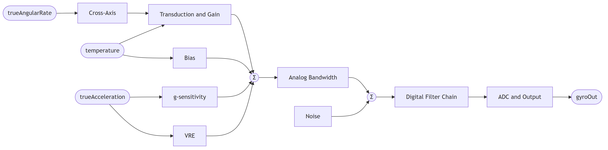

# Behavior Reference

This page describes how each sensor behavior is modeled in the ADIS16607 simulation,
expressed as a signal-processing chain from physical input to digital output.

---

## Signal-Path Overview

Each sensor channel (gyroscope and accelerometer) passes through the same ordered
cascade. The diagram below shows the gyroscope channel; the accelerometer channel
is identical except that it has no g-sensitivity.



---

## Gyroscope Channel

### Cross-Axis Coupling

Applies a 3×3 sensor-to-package misalignment matrix to the true angular rate vector.
The diagonal is unity; off-diagonal elements represent inter-axis leakage.

```
true rate (3-axis) → 3×3 misalignment matrix → cross-axis-mixed rate
```

Off-diagonal elements are drawn once per simulation run from a zero-mean Gaussian
(or pinned to a deterministic corner value). The sizing is derived from the datasheet
orthogonality specification.

### Scale-Factor and Sensitivity

Applies three gain effects to the cross-axis-mixed rate, independently per axis:

```
rate_in → (1 + SF error) × (1 + temperature drift) × rate_in + nonlinearity → rate_out
```

| Effect | Implementation |
|---|---|
| Per-run scale-factor error | Constant multiplicative error, drawn once per run. |
| Over-temperature sensitivity drift | Polynomial mean curve ψ(T) fitted to published sensitivity-vs-temperature data, plus a per-run additive offset of that curve. |
| Static nonlinearity | Odd-order polynomial (k ≥ 3) deviation from the ideal straight-line characteristic. |

### Bias and Offset

Adds per-run static bias and temperature-dependent bias drift to the scaled rate.
Also receives injected perturbations from the g-sensitivity and vibration paths.

```
scaled rate + static bias + over-temperature residual + g-sensitivity rate + VRE bias → assembled rate
```

| Effect | Implementation |
|---|---|
| Static bias | Constant zero-rate offset (initial + repeatability), drawn once per run. |
| Over-temperature bias | Polynomial mean curve φ(T) scaled by a per-run amplitude draw, plus a per-run additive curve offset. Reproduces the published bias-vs-temperature ±3σ band. |

### G-Sensitivity and Vibration Rectification

Acceleration-to-rate coupling operating as a side-chain:

**G-sensitivity (linear coupling):**

```
acceleration (3-axis) → coupling matrix × acceleration → spurious rate (3-axis)
```

A fixed 3×3 matrix converts applied acceleration into a parasitic angular rate per axis.

**Vibration rectification error (VRE):**

```
acceleration → band-pass (55–370 Hz) → square → sum axes → low-pass average
  → square root → level-curve polynomial → DC bias (scalar, all axes)
```

The envelope detector extracts the running RMS vibration amplitude, then a positive-coefficient
polynomial (passing through the origin) maps it to a rectified DC rate bias. This bias is
identical on all three gyroscope axes.

> [!WARNING]
> Only vibration content between 55 Hz and 370 Hz contributes to the rectified bias.
> Acceleration outside this band (rigid-body motion, gravity, high-frequency content) is
> rejected by the band-pass filter and does not produce a VRE output.

### Noise Sources

Additive rate noise summed onto the channel after the analog bandwidth stage:

```
noise output = white noise (ARW) + Gauss–Markov bank (bias instability)
```

| Component | Description |
|---|---|
| Angle random walk (ARW) | White noise with flat power spectral density. Produces the −½ slope on an Allan variance plot. Sized by the datasheet ARW coefficient. |
| Bias instability | Bank of first-order Gauss–Markov (Ornstein–Uhlenbeck) processes. Summed sections produce the flat bias-instability floor on the Allan variance plot. |

### Analog Bandwidth

Band-limits the assembled gyro rate with a single fixed real pole:

```
assembled rate → single-pole low-pass filter → band-limited rate (discrete at f_S)
```

The pole frequency is derived from the datasheet analog bandwidth specification.
This stage also forms the analog-to-digital boundary: the output is sampled at the
conversion rate f_S = f₀ / 8.

---

## Accelerometer Channel

### Cross-Axis Coupling

Applies a 3×3 sensor-to-package misalignment matrix to the true specific-force vector.
Structure is identical to the gyroscope cross-axis stage, with accelerometer-specific parameters.

```
true acceleration (3-axis) → 3×3 misalignment matrix → cross-axis-mixed acceleration
```

### Scale-Factor and Sensitivity

Applies gain effects to the cross-axis-mixed specific force, independently per axis:

```
accel_in → (1 + SF error) × (1 + temperature drift) × accel_in + nonlinearity → accel_out
```

| Effect | Implementation |
|---|---|
| Per-run scale-factor error | Constant multiplicative error, drawn once per run. |
| Over-temperature sensitivity drift | Polynomial mean curve fitted to published sensitivity-vs-temperature data, plus a per-run additive offset. |
| Static nonlinearity | General polynomial (orders k ≥ 2) deviation from the ideal straight-line characteristic. |

### Bias and Offset

Adds per-run static bias and temperature-dependent bias drift to the scaled acceleration.
Also receives the vibration rectification bias.

```
scaled acceleration + static bias + over-temperature residual + VRE bias → assembled acceleration
```

| Effect | Implementation |
|---|---|
| Static bias | Constant zero-g offset (initial + repeatability combined in quadrature), drawn once per run. |
| Over-temperature bias | Polynomial mean curve φ(T) scaled by a per-run amplitude draw, plus a per-run additive curve offset. Reproduces the published bias-vs-temperature ±3σ band. |

### Vibration Rectification

Same envelope-detector architecture as the gyroscope VRE path:

```
acceleration → band-pass (55–370 Hz) → square → sum axes → low-pass average
  → square root → level-curve polynomial → DC bias (scalar, all axes)
```

The accelerometer level-curve is predominantly quadratic (bias grows as vibration²),
consistent with the datasheet VRE coefficient in mg/g² units.

> [!WARNING]
> Only vibration content between 55 Hz and 370 Hz contributes to the rectified bias.
> Acceleration outside this band is rejected by the band-pass filter and does not produce
> a VRE output.

### Noise Sources

Additive acceleration noise summed onto the channel after the analog bandwidth stage:

```
noise output = white noise (VRW) + Gauss–Markov bank (bias instability)
```

| Component | Description |
|---|---|
| Velocity random walk (VRW) | White noise with flat power spectral density. Produces the −½ slope on an Allan variance plot. Sized by the datasheet VRW coefficient. |
| Bias instability | Bank of first-order Gauss–Markov processes producing the flat bias-instability floor on the Allan variance plot. |

### Analog Bandwidth

Band-limits the assembled accelerometer signal with a single fixed real pole:

```
assembled acceleration → single-pole low-pass filter → band-limited acceleration (discrete at f_S)
```

The accelerometer analog pole frequency lies above the Nyquist frequency of the internal
sample clock. The primary effect is sub-sample group delay rather than magnitude attenuation
within the passband.

---

## Digital Signal Chain

Both channels pass through the same three-stage digital pipeline (separate instances,
shared architecture). All stages operate at the conversion rate f_S = f₀ / 8,
except the decimator output which runs at the output data rate.

```
input samples (at f_S)
  → Stage 1: 2-sample moving average (fixed)
  → Stage 2: configurable bi-quad IIR low-pass (selected by FILT_BW register)
  → Stage 3: D-sample averaging decimator
  → output samples (at f_ODR)
```

| Stage | Description |
|---|---|
| Moving average | Fixed 2-tap FIR: ½ × (current + previous sample). Unity DC gain, ½-sample group delay. |
| Bi-quad IIR | Second-order low-pass with coefficients selected by the `FILT_BW` configuration. Setting `FILT_BW = 0` bypasses this stage (pass-through). |
| Decimator | Averages D consecutive samples and outputs one result per D input samples. D = `DEC_RATE` + 1. Unity DC gain. |

**Output data rate:**

```
f_ODR = f_S / D = (f₀ / 8) / (DEC_RATE + 1)
```

**Total group delay** is the sum of each stage's contribution: moving-average delay +
IIR filter phase delay + decimator averaging delay.

---

## ADC Quantization and Output Encoding

The final stage quantizes each filtered sample onto the device LSB grid:

```
filtered sample → round to nearest LSB → saturate at ±full-scale → quantized output
```

| Aspect | Description |
|---|---|
| Quantization | Deterministic round-to-nearest. No stochastic dither is added. |
| Saturation | Inputs beyond ±full-scale are clamped to the end codes (no wraparound). |
| Resolution modes | 16-bit or 24-bit word width, selectable at runtime. Both modes share the same full-scale range; selecting 24-bit increases resolution by 256×. |
| Output format | Two's-complement encoding. The model delivers a double-precision value that is bit-identical to the decoded device register. |

**LSB weight:**

```
LSB = full-scale / 2^(b − 1)      where b ∈ {16, 24}
```

---

## Per-Run Stochastic Effects

Several model effects are drawn once at simulation start and held constant for the
entire run. Each draw can operate in one of two modes:

| Mode | Description |
|---|---|
| **Random** | Value drawn from a zero-mean Gaussian, truncated at ±3σ. Each run produces a different device realization. |
| **Multiplier** | Value pinned to m × 3σ, where m ∈ [−1, +1]. Enables deterministic sweeps of worst-case corners without randomness. |

Stochastic draws are independent across sensor axes and between gyroscope and
accelerometer channels unless otherwise stated.

---

## Symbols and Abbreviations

| Term | Meaning |
|---|---|
| f₀ | Gyro resonator frequency (user-settable input; anchors all internal clocks) |
| f_S | Conversion rate = f₀ / 8 |
| f_ODR | Output data rate = f_S / (DEC_RATE + 1) |
| T | Operating temperature (°C) |
| ARW | Angle random walk |
| VRW | Velocity random walk |
| VRE | Vibration rectification error |
| LSB | Least significant bit (quantization step size) |
| FILT_BW | IIR filter bandwidth configuration register |
| DEC_RATE | Decimation ratio configuration register |

---

## Related Pages

- [Behavior](behavior.md) — summary of modeled effects
- [Interfaces](interfaces.md) — operating envelope, signals, configuration parameters
- [Fidelity](fidelity.md) — accuracy targets and verification approach
- [Limitations](limitations.md) — effects not modeled

---

Copyright © 2026 Analog Devices, Inc.

Licensed under the Apache License, Version 2.0. See [LICENSE](../LICENSE) for the full text.
