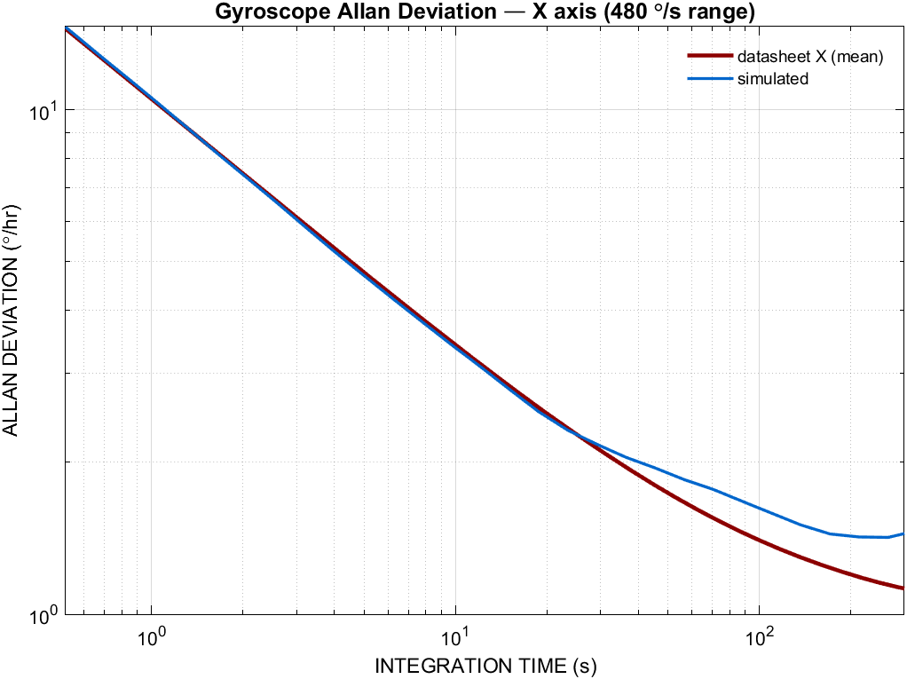
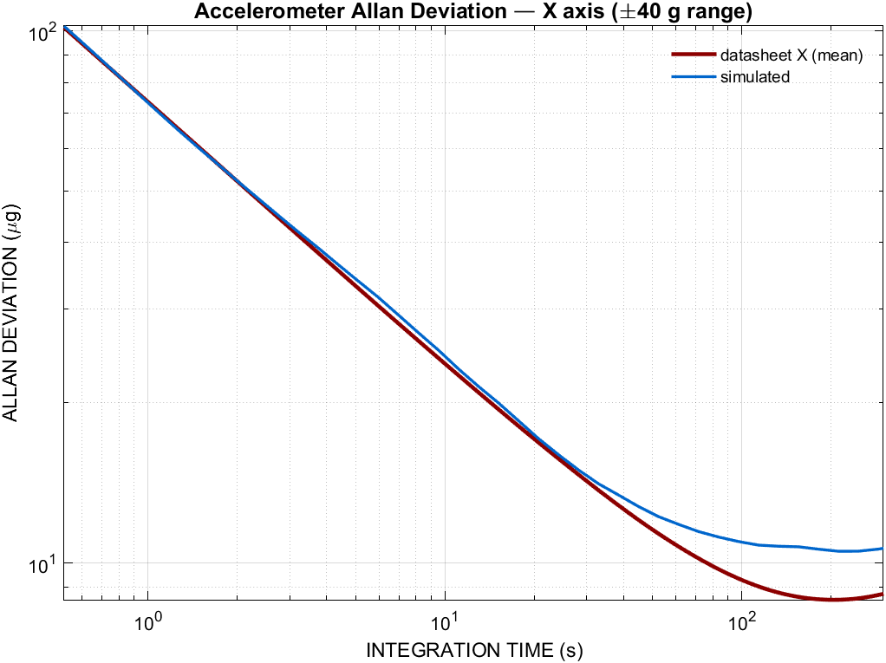
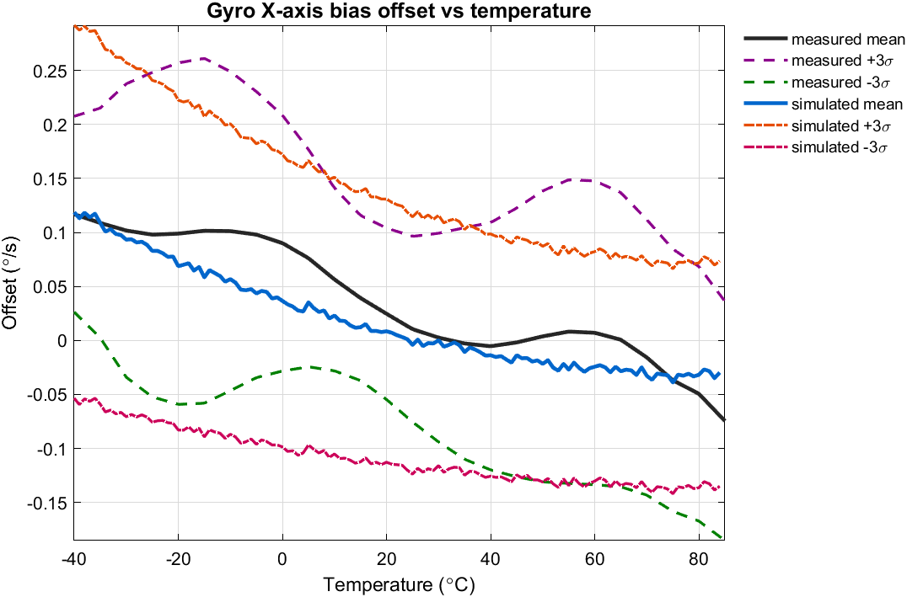
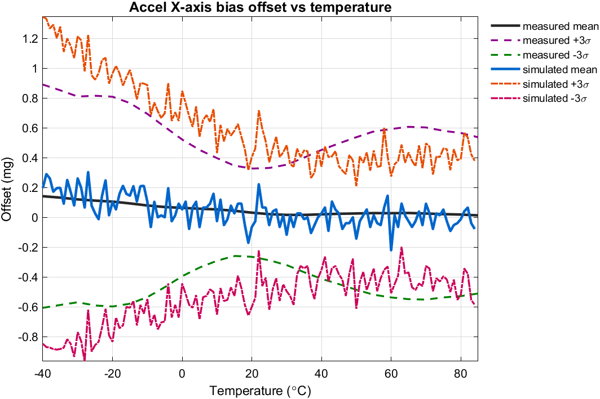
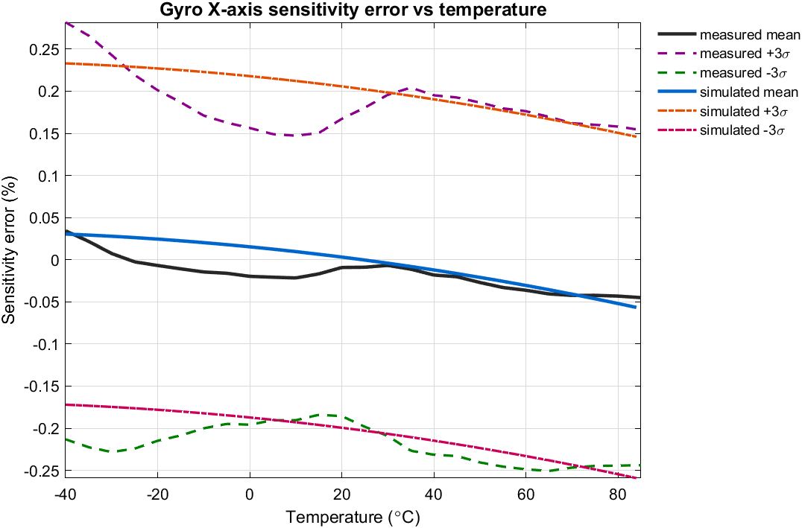
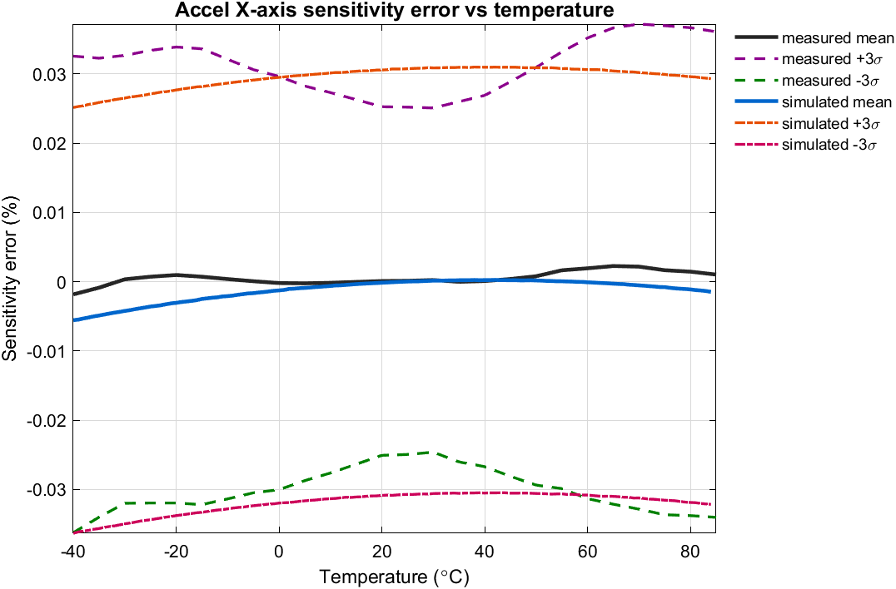
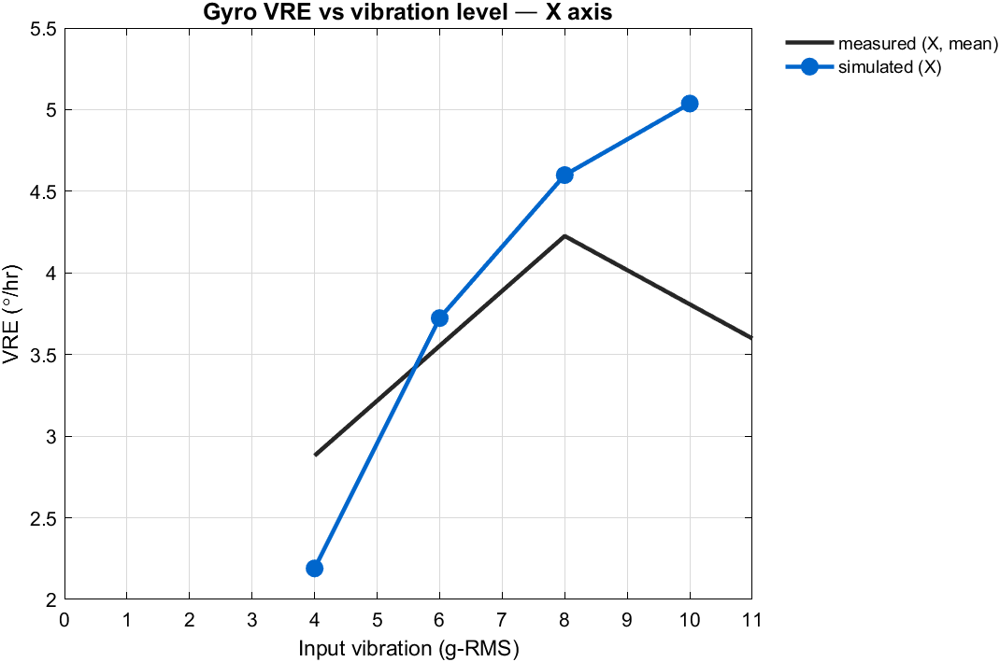
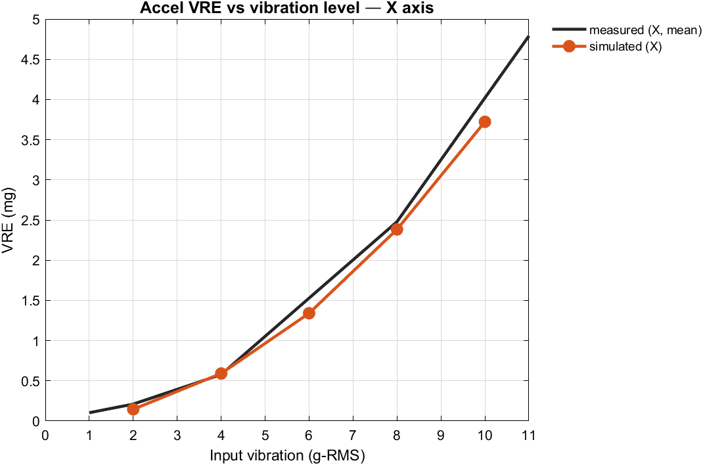
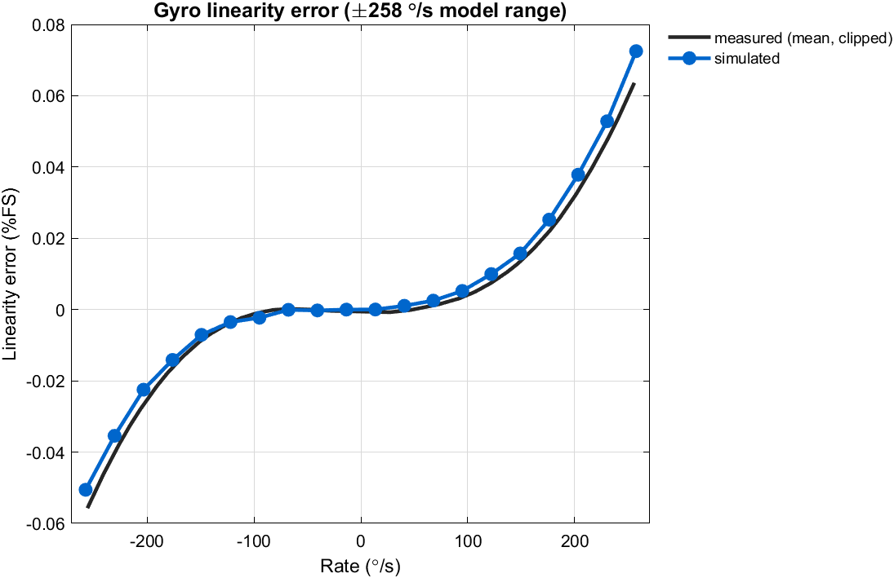
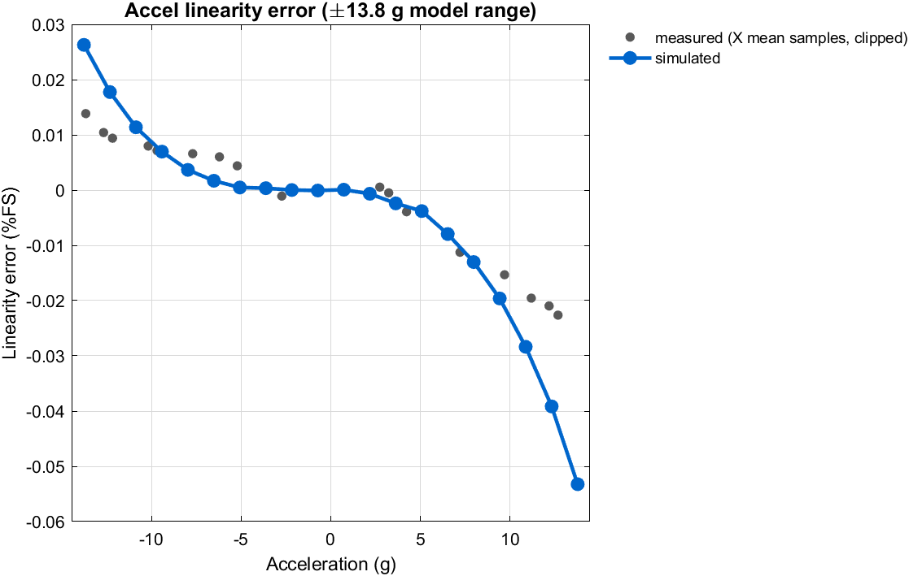

# Fidelity

This page defines how model accuracy is measured and what acceptance criteria apply.

---

## Definition

Fidelity is the degree of agreement between model-derived characterization results and the ADIS16607 datasheet specifications.

Agreement is evaluated in both domains:

- **Time domain** — settling behavior, time-series statistics (mean, standard deviation).
- **Frequency domain** — power spectral density shape, Allan-deviation metrics.

---

## Acceptance Criteria

| Condition | Requirement |
|---|---|
| Datasheet provides min/max bounds | Model results remain within those bounds |
| Datasheet provides typical-only values | Model matches typical ±2 % |
| Rate-chain consistency | f_S = f_0 / 8; ODR = f_S / (DEC_RATE + 1) |

---

## Datasheet Reproduction Figures

The figures below reproduce key ADIS16607 datasheet characterization curves using the model. Each plot is generated by configuring the model with the stated conditions and comparing the output against the corresponding datasheet specification.

### Gyro Allan Deviation

*Allan deviation σ(τ) computed from `gyroOut` under zero-rate, static-gravity conditions. Conditions: `trueAngularRate=[0;0;0]`, `trueAcceleration=[0;0;9.81]`, `temperature=25`; `FiltBw=0`, `DecRate=199`, `GyroResonatorFreqHz=78000`, `WordSize=24` (the reproduction plot was generated at a reduced `f0=8000`, `DecRate=19` to bound runtime; the decimation filter preserves ODR and noise bandwidth, so the curve is equivalent); all `"±3σ multiplier"` parameters set to 0.*

---

### Accelerometer Allan Deviation

*Allan deviation σ(τ) computed from `accelOut` under zero-rate, static-gravity conditions. Same configuration as gyro Allan deviation.*

---

### Gyro Bias vs. Temperature

*Mean `gyroOut` per temperature step over a −40 → +85 °C ramp. Conditions: `trueAngularRate=[0;0;0]`, `trueAcceleration=[0;0;9.81]`; `FiltBw=0`, `DecRate=99`; bias-drift multiplier swept (0/±1), all others = 0.*

---

### Accelerometer Bias vs. Temperature

*Mean `accelOut` per temperature step over a −40 → +85 °C ramp. Same motion/config as gyro bias-vs-T; accel bias-drift multiplier swept, others = 0.*

---

### Gyro Scale Factor vs. Temperature

*Differential scale-factor deviation `(gyroOut(+ω) − gyroOut(−ω)) / (2ω) − 1` vs. temperature, with cubic nonlinearity corrected analytically. Conditions: `trueAngularRate=[±5;0;0]` rad/s (≈ ±286.5 °/s), `trueAcceleration=[0;0;9.81]`, T ramp −40 → +84 °C; `FiltBw=0`, `DecRate=0`; SF-drift multiplier swept (0/±1), others = 0.*

---

### Accelerometer Scale Factor vs. Temperature

*Differential SF deviation `(accelOut(+a) − accelOut(−a)) / (2a) − 1` vs. temperature, with cubic nonlinearity corrected analytically. Conditions: `trueAcceleration=[±150;0;9.81]` (≈ ±15.3 g), T ramp; `FiltBw=0`, `DecRate=0`; accel SF-drift multiplier swept (0/±1), others = 0.*

---

### Gyro Vibration Rectification Error

*Mean DC shift of `gyroOut` under broadband random vibration (55–370 Hz) at swept RMS levels. Conditions: `trueAngularRate=[0;0;0]`; `FiltBw=0`, `DecRate=99`; all multipliers = 0.*

---

### Accelerometer Vibration Rectification Error

*Mean DC shift of `accelOut` under the same 150 Hz single-tone vibration stimulus as the gyro VRE reproduction, RMS swept 2/4/6/8/10 g. Conditions: `trueAngularRate=[0;0;0]`; `FiltBw=0`, `DecRate=0`; all multipliers = 0.*

---

### Gyro Nonlinearity

*Residual (output − best-fit line) in % FS over stepped rate ±286.5 °/s (20 steps, model range ±5 rad/s). Conditions: `trueAcceleration=[0;0;9.81]`, 25 °C; `FiltBw=0`, `DecRate=0`; all multipliers = 0. *

---

### Accelerometer Nonlinearity

*Residual (output − best-fit line) in % FS over stepped acceleration ±13.8 g (20 steps), zero rate, 25 °C. `FiltBw=0`, `DecRate=0`; all multipliers = 0.*

---

## Related Pages

- [Behavior](behavior.md) — what the model reproduces
- [Interfaces](interfaces.md) — signal definitions, configuration parameters
- [Limitations](limitations.md) — scope boundaries and assumptions

---

Copyright © 2026 Analog Devices, Inc.

Licensed under the Apache License, Version 2.0. See [LICENSE](../LICENSE) for the full text.
